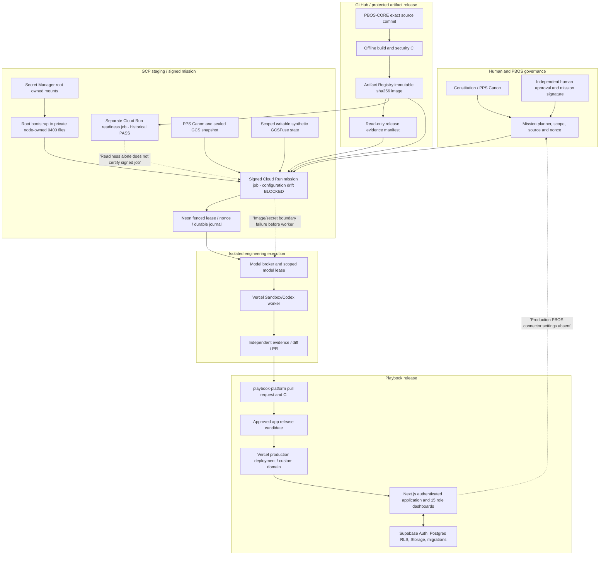

# Evidence-backed complete-system dependency map

## Actual authority boundaries

| Boundary | Expected contract | Current independently supported result | Evidence |
|---|---|---|---|
| GitHub → Artifact Registry | Image built/tested, full immutable sha256 retained | Nonmission readiness image published and executed | SRC-GCP-READINESS |
| Registry → signed job | Approved exact digest equals reconciled signed-job digest | **Failed audit:** signed image differs from readiness pin; historical execution differed from current job | SRC-GCP-AUDIT |
| Managed secrets → signed controller | Root copies managed files to `0400` regular files, then drops to node | Script exists; **deployed signed job path differs**; runtime `5dhzb` mode failure is operator reported | SRC-GCP-CONTROL; SRC-GCP-AUDIT; SRC-GCP-OPERATOR |
| Mission job → Neon/GCS | Private disposable scoped state; read-only Canon; signed nonce and fenced lease | Signed execution-state read/write policy differs; full fenced mission unproven | SRC-GCP-AUDIT; SRC-NEON |
| Signed controller → model broker → Sandbox | Only signed approved mission can dispatch; output independently reviewed | Last incidents failed before admission; 0/2 completed | SRC-GCP-OPERATOR |
| GitHub application main → Vercel | Accepted revision deployed exactly and promoted | Main Git deployment disabled; last production deployment behind main | SRC-APP-VERCEL-CONFIG; SRC-APP-REPO; SRC-VERCEL-PROJECT |
| Vercel runtime → PBOS API | Production endpoint, organization, connector signing, per-journey approvals | **Absent** from current production Vercel env key inventory | SRC-VERCEL-ENV; SRC-APP-REPO |
| App user → Supabase Auth/RLS | Owner identity and appropriate approved role/relationship permissions | 166 public tables RLS enabled; 254 linter findings need per-object review; complete 15-role production E2E not proven | SRC-SUPABASE-PROJECT; SRC-SUPABASE-ADVISORS; SRC-APP-QA |
| CI → production user acceptance | Safe exact-release all-role journeys including denials, recovery, return login | Isolated local QA passed; latest production main QA blocked at config | SRC-APP-QA-LOCAL; SRC-APP-QA |
| Release → operational governance | Live ledger, observability, rollback, human acceptance | Old 207-task tracker has no owners/dependencies; no certified rollback | SRC-PROJECT-TRACKER |

**Identity labels are not equivalent to actual operating readiness.** Approved PR ≠ deployed job ≠ runtime mode ≠ executed mission ≠ accepted Playbook release ≠ 15 working roles.